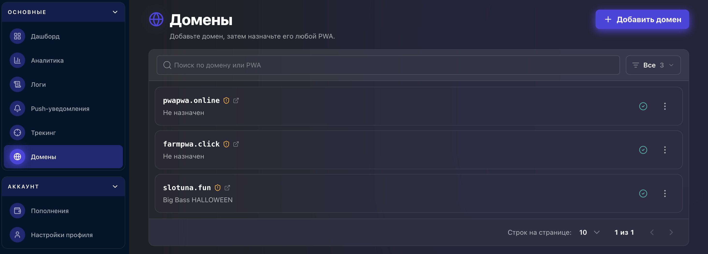
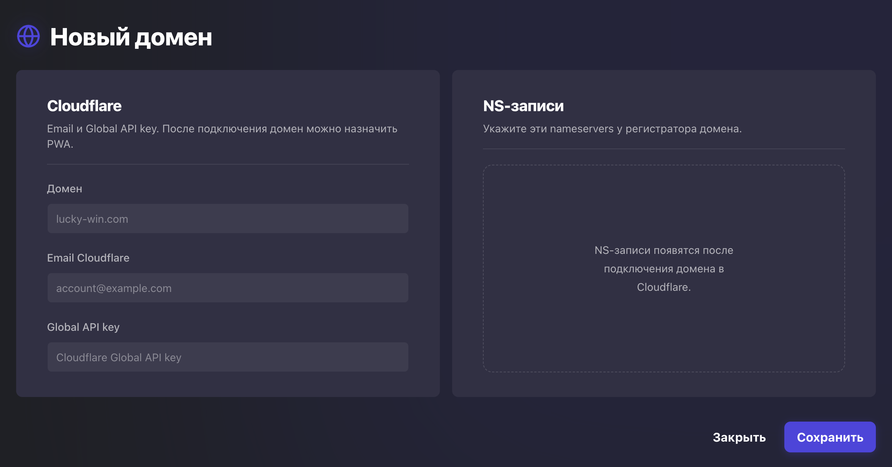

Вкладка **«Домены»** предназначена для подключения и управления доменами, которые используются в PWA-приложениях. Здесь отображается список всех добавленных доменов, их текущий статус и назначенное PWA.

В верхней части страницы доступны поиск по домену или PWA, фильтр списка и кнопка **Добавить домен** для подключения нового домена.

<Frame>
  
</Frame>

## Добавление нового домена

Для подключения домена нажмите **Добавить домен** и заполните данные Cloudflare:

<Frame>
  
</Frame>

- **Домен** — укажите доменное имя.
- **Email Cloudflare** — электронную почту аккаунта Cloudflare.
- **Global API Key** — глобальный API-ключ Cloudflare.

После заполнения нажмите **Сохранить**. Сервис автоматически подключит домен к Cloudflare и сформирует NS-записи.

## Настройка NS-записей

После успешного подключения в правой части окна появятся NS-записи. Их необходимо указать у регистратора домена, заменив текущие серверы имён на предоставленные системой.

После смены серверов имён дождитесь подтверждения от Cloudflare. Пока домен проверяется, в кабинете отображается статус **Ожидание NS**. Когда статус изменится на **Активен**, домен можно выбрать в редакторе PWA, если он свободен. Если домен уже привязан к другому приложению, сначала снимите текущую привязку.
