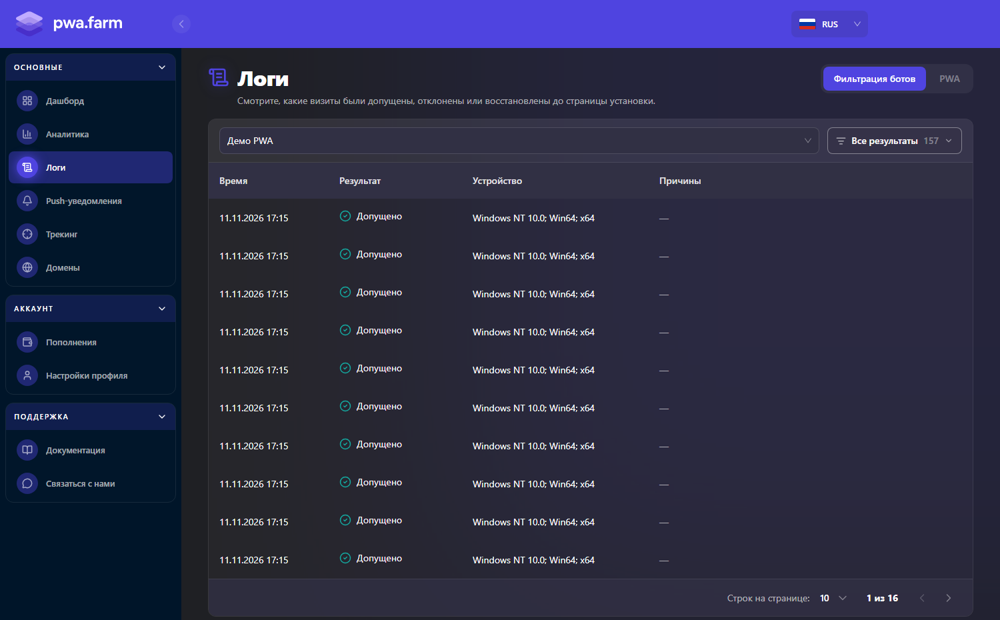

В боковом меню личного кабинета откройте **Логи**, чтобы проверить результаты обработки визитов до страницы установки PWA.

<Frame>
  
</Frame>

## 1. Выбор приложения

Откройте вкладку **Фильтрация ботов** и выберите приложение в верхней части страницы.

## 2. Переключение режима логов

Если на вкладке **PWA** отображается **Coming soon**, для просмотра результатов проверки используйте **Фильтрация ботов**.

## 3. Фильтрация по результату

Справа находится фильтр **Все результаты**, позволяющий отображать записи по их статусу:

- **Все результаты** — все записи проверки для выбранного приложения.
- **Допущено** — визиты, которым разрешён доступ.
- **Отказ** — визиты, которым отказано в доступе.
- **Допуск восстановлен** — визиты, для которых ранее выданный допуск восстановлен.

Рядом с фильтром отображается количество найденных записей.

## 4. Таблица логов

Для каждого визита отображается следующая информация:

| Поле | Описание |
| --- | --- |
| **Время** | Дата и время визита |
| **Результат** | Результат проверки визита |
| **Устройство** | Данные об устройстве, если они определены |
| **Причины** | Причины отказа, если они указаны |
