Раздел **«PUSH-уведомления»** предназначен для создания, управления и отслеживания push-уведомлений, отправляемых пользователям PWA-приложения.

В верхней части страницы отображаются вкладки с количеством уведомлений по их статусу:

- **Все** — список всех созданных push-уведомлений.
- **Действующие** — активные уведомления, которые доступны для отправки или уже участвуют в рассылке.
- **Отключенные** — все неактивные уведомления, включая рассылки, сохранённые как черновики.

Для быстрого поиска нужного уведомления предусмотрено **поле поиска** по названию.

В таблице отображается информация о каждом push-уведомлении:

- **Название** — название уведомления.
- **Дата создания** — дата, когда уведомление было создано.
- **Статус** — текущее состояние уведомления, **Активен** или **Черновик**.

Чтобы изменить уведомление, нажмите значок редактирования в строке. Чтобы выключить рассылку, откройте её, выключите **Активировать рассылку** и нажмите **Сохранить**. Меню действий в строке позволяет дублировать или удалять уведомление.

<Frame>
  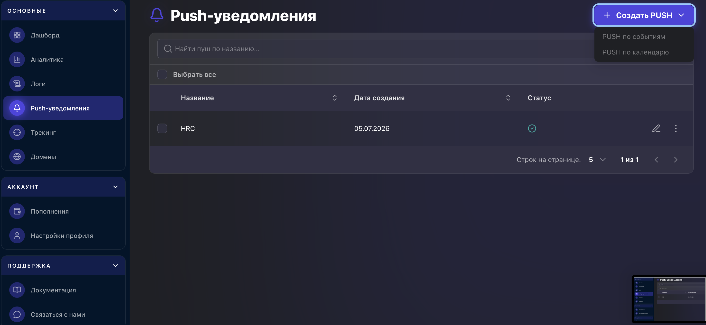
</Frame>

Для того, чтобы создать новый PUSH, в правом верхнем углу нажимаем **Создать PUSH**

<Frame>
  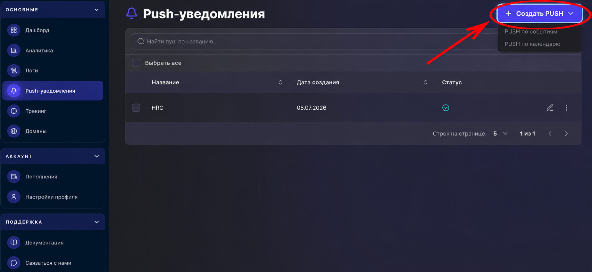
</Frame>

Далее нам нужно выбрать

- по событиям
- по календарю

<Frame>
  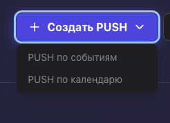
</Frame>

## PUSH по событиям

<Frame>
  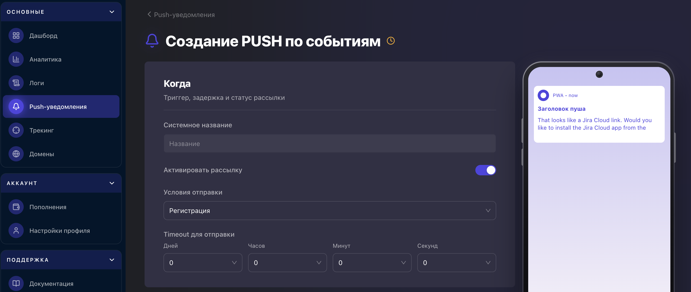
</Frame>

Раздел **«Создание PUSH по событиям»** предназначен для настройки автоматической отправки push-уведомлений пользователям при наступлении определенного события. После создания и активации такого уведомления система самостоятельно отправляет его новым пользователям, соответствующим заданным условиям.

При создании push-уведомления необходимо заполнить следующие параметры:

- **Системное название** — внутреннее название уведомления, которое отображается только в интерфейсе платформы и используется для удобства управления созданными push-уведомлениями.
- **Активировать рассылку** — переключатель, который включает или отключает автоматическую отправку уведомления. Если функция активирована, уведомление будет отправляться пользователям при выполнении выбранного события.
- **Условия отправки** — выбор события, которое служит триггером для отправки push-уведомления. Например, отправка может происходить после регистрации пользователя или другого доступного события. После наступления выбранного события запускается отсчет времени до отправки уведомления.
- **Timeout для отправки** — настройка задержки между наступлением события и отправкой уведомления. Задержка задается отдельно в:
  - днях;
  - часах;
  - минутах;
  - секундах. Это позволяет отправлять уведомление как сразу после события, так и спустя любой необходимый промежуток времени.

<Frame>
  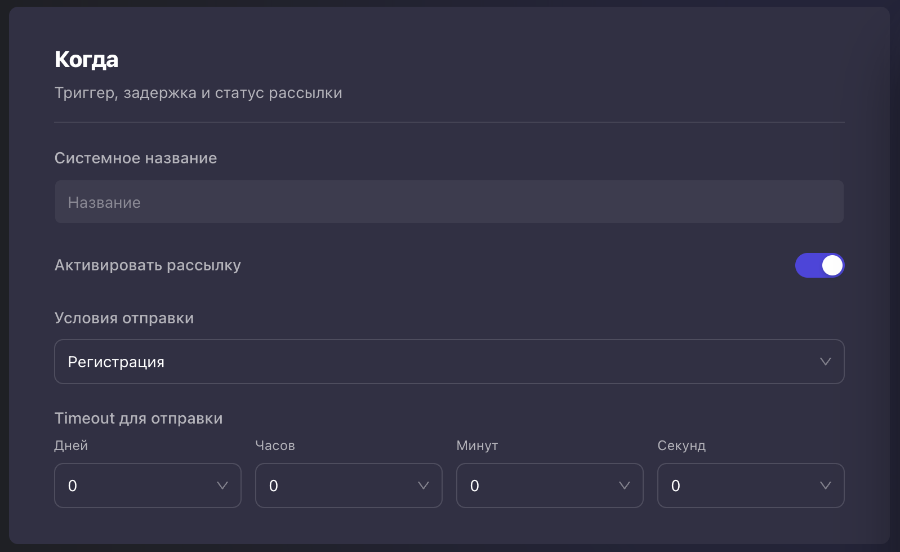
</Frame>

### Раздел Кому

<Frame>
  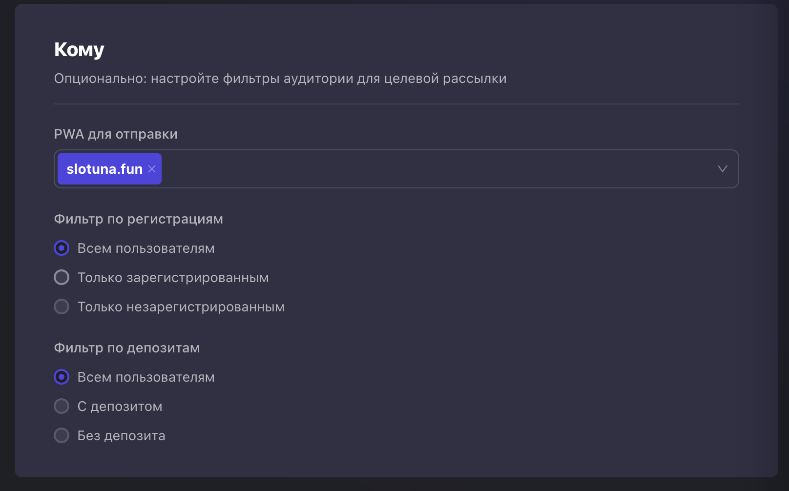
</Frame>

Раздел «Кому» предназначен для выбора аудитории, которой будет отправлено PUSH-уведомление. Здесь можно указать PWA-приложение и настроить фильтры получателей.

Доступны следующие параметры:

- PWA для отправки — выбор PWA, пользователи которого получат уведомление.
- Фильтр по регистрациям:
  - Всем пользователям — отправка всей аудитории;
  - Только зарегистрированным — только пользователям с регистрацией;
  - Только незарегистрированным — только пользователям без регистрации.
- Фильтр по депозитам:
  - Всем пользователям
  - С депозитом — только пользователям, совершившим депозит;
  - Без депозита — только пользователям без депозита.

### Раздел Сообщение

<Frame>
  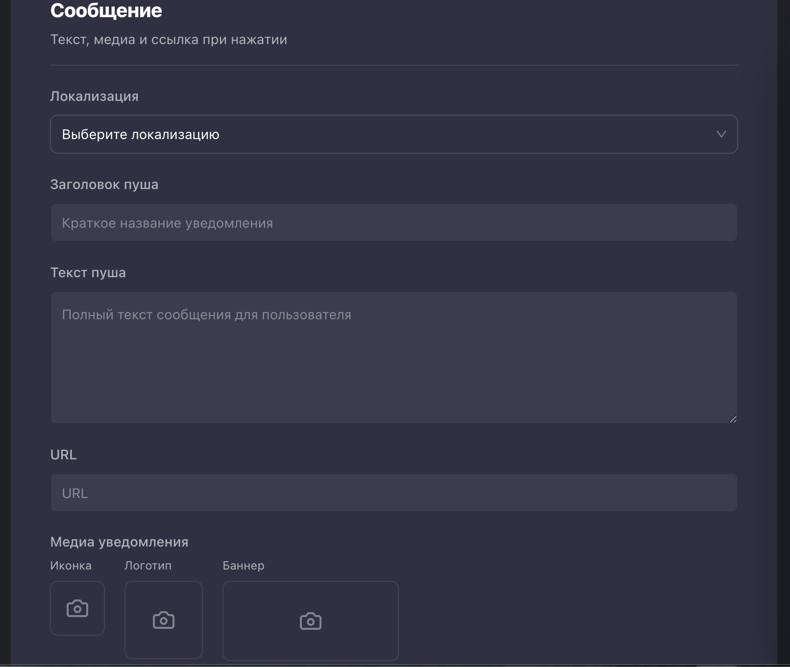
</Frame>

Раздел **«Сообщение»** предназначен для настройки содержимого push-уведомления, которое будет отображаться пользователю после выполнения выбранного события.

В блоке доступны следующие параметры:

- **Локализация** — выберите языки, на которые PWA Farm автоматически переведёт уведомление после сохранения.
- **Заголовок пуша** — краткий заголовок уведомления, который отображается в верхней части push-сообщения. Заголовок должен быть информативным и привлекать внимание пользователя.
- **Текст пуша** — основное содержание уведомления. Здесь указывается сообщение, которое увидит пользователь после получения push-уведомления. Текст рекомендуется делать кратким, понятным и содержащим призыв к действию, если это необходимо.

Введите исходные заголовок и текст один раз. При отправке PWA Farm подбирает перевод по языку пользователя.

В поле **URL** укажите адрес, который откроется при нажатии на уведомление. Если оставить поле пустым, откроется адрес домена PWA.

<Frame>
  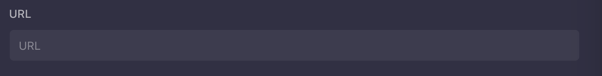
</Frame>

В разделе **«Медиа уведомления»** нужно настроить визуальное оформление push-уведомления.

Доступны три типа изображений:

- **Иконка** — основная иконка, отображаемая в push-уведомлении.
- **Логотип** — логотип уведомления. Он автоматически обрезается до соотношения сторон **1:1**.
- **Баннер** — широкое изображение для отображения в уведомлении.

<Frame>
  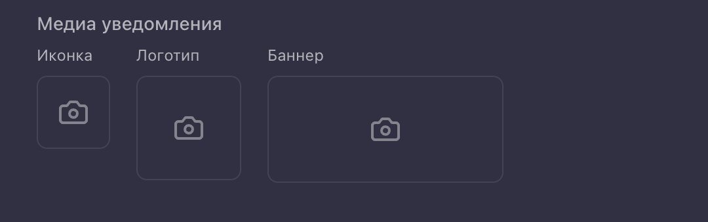
</Frame>

Для сохранения PUSH - уведомления нажимаем кнопку **Сохранить** в правом нижнем углу.

## PUSH по календарю

### Конфигурация PUSH по расписанию

<Frame>
  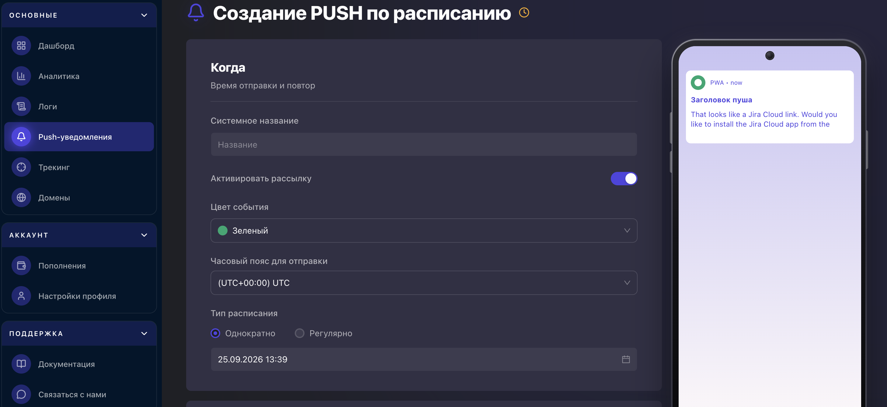
</Frame>

#### В разделе **«Когда»** задаются основные параметры рассылки по расписанию.

Доступны следующие настройки:

**Системное название** — внутреннее название рассылки, которое отображается в интерфейсе [pwa.farm](https://www.pwafarm.app/) и используется для ее идентификации. Пользователи не видят это название.

**Активировать рассылку** — переключатель, позволяющий включить или отключить отправку push-уведомлений. После активации уведомления будут отправляться в соответствии с заданным расписанием.

**Цвет события** — выбор цветовой метки для визуальной идентификации рассылки в календаре PWA Farm. Цвет используется только для отображения в интерфейсе и не влияет на отправку или содержимое push-уведомления.

**Часовой пояс для отправки** — выбор часового пояса, относительно которого будет выполняться отправка push-уведомлений. Это позволяет отправлять уведомления в заданное локальное время независимо от местоположения пользователей.

**Тип расписания** — определяет периодичность отправки уведомлений:

- **Однократно** — уведомление будет отправлено один раз в указанную дату и время.
- **Регулярно** — уведомление будет отправляться по повторяющемуся расписанию (после выбора этого режима становятся доступны дополнительные параметры настройки периодичности).

Для **Однократно** выберите дату и время отправки. Для **Регулярно** задайте время отправки, дни недели, а также **Начало повторения** и **Конец повторения**. Время рассчитывается по выбранному часовому поясу.

<Frame>
  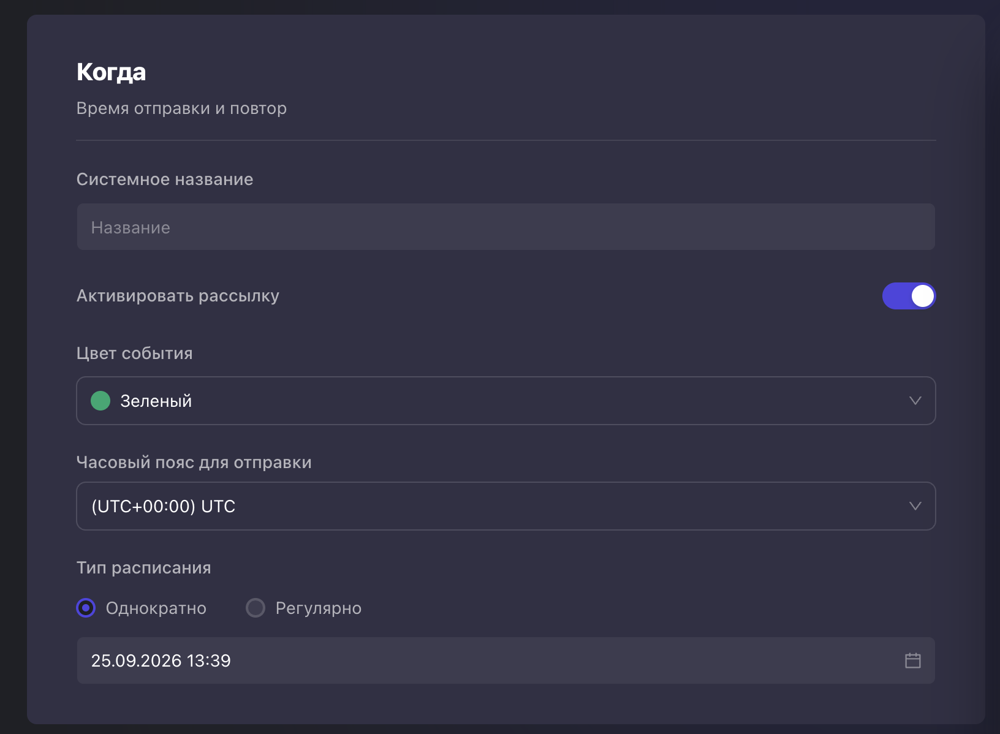
</Frame>

### Раздел Кому

<Frame>
  
</Frame>

Раздел «Кому» предназначен для выбора аудитории, которой будет отправлено PUSH-уведомление. Здесь можно указать PWA-приложение и настроить фильтры получателей.

Доступны следующие параметры:

- PWA для отправки — выбор PWA, пользователи которого получат уведомление.
- Фильтр по регистрациям:
  - Всем пользователям — отправка всей аудитории;
  - Только зарегистрированным — только пользователям с регистрацией;
  - Только незарегистрированным — только пользователям без регистрации.
- Фильтр по депозитам:
  - Всем пользователям
  - С депозитом — только пользователям, совершившим депозит;
  - Без депозита — только пользователям без депозита.

### Раздел Сообщение

<Frame>
  
</Frame>

В разделе **Сообщение** настройте содержимое уведомления, которое получат подписчики в запланированное время.

В блоке доступны следующие параметры:

- **Локализация** — выберите языки, на которые PWA Farm автоматически переведёт уведомление после сохранения.
- **Заголовок пуша** — краткий заголовок уведомления, который отображается в верхней части push-сообщения. Заголовок должен быть информативным и привлекать внимание пользователя.
- **Текст пуша** — основное содержание уведомления. Здесь указывается сообщение, которое увидит пользователь после получения push-уведомления. Текст рекомендуется делать кратким, понятным и содержащим призыв к действию, если это необходимо.

Введите исходные заголовок и текст один раз. При отправке PWA Farm подбирает перевод по языку пользователя.

В поле **URL** укажите адрес, который откроется при нажатии на уведомление. Если оставить поле пустым, откроется адрес домена PWA.

<Frame>
  
</Frame>

В разделе **«Медиа уведомления»** нужно настроить визуальное оформление push-уведомления.

Доступны три типа изображений:

- **Иконка** — основная иконка, отображаемая в push-уведомлении.
- **Логотип** — логотип уведомления. Он автоматически обрезается до соотношения сторон **1:1**.
- **Баннер** — широкое изображение для отображения в уведомлении.

<Frame>
  
</Frame>

Для сохранения PUSH - уведомления нажимаем кнопку **Сохранить** в правом нижнем углу.
