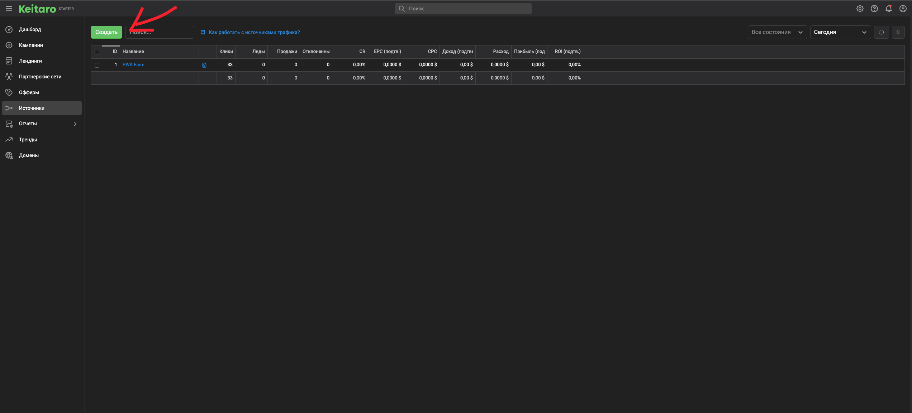

## Передайте идентификатор визита в Keitaro

1. В Keitaro откройте **Источники**, нажмите **Создать** и сохраните источник с названием **PWA Farm**.

   <Frame>
     
   </Frame>

2. В настройках нужной кампании Keitaro выберите **PWA Farm** как источник трафика.
3. В PWA Farm откройте редактор приложения и на шаге **Оффер** укажите ссылку кампании Keitaro. Добавьте в неё `external_id={click_id}`, чтобы Keitaro сохранил исходный идентификатор визита в поле **External ID**. Если в ссылке уже есть параметры, добавьте этот параметр через `&`. Если в настройках кампании для **External ID** задано другое имя входящего параметра, используйте его в ссылке оффера.

## Настройте исходящие постбэки

В настройках кампании Keitaro откройте вкладку **S2S Postbacks**. Добавьте отдельную запись для каждого события и выберите метод **GET**. Для каждой записи укажите статус, с которым ваш источник конверсий передаёт это событие в Keitaro. [Настройка S2S в кампании Keitaro](https://docs.keitaro.io/ru/campaigns-and-streams/s2s-postback.html)

**Регистрация**

```text
https://api.pwafarm.app/knocks/?click_id={external_id}&event=registration
```

**Депозит**

```text
https://api.pwafarm.app/knocks/?click_id={external_id}&event=deposit&profit={conversion_revenue:usd}&currency=usd
```

Пример депозита подходит, если Keitaro получает сумму депозита как доход по конверсии. `{conversion_revenue:usd}` подставляет доход в долларах. В Keitaro `{profit}` означает прибыль после вычета расходов. Если сумма хранится в другом поле, подставьте макрос этого поля и укажите соответствующую валюту. [Макросы исходящих постбэков Keitaro](https://docs.keitaro.io/ru/campaigns-and-streams/s2s-postback-placeholders.html)

Если исходный идентификатор визита сохранён, например, в `sub_id_1`, укажите `click_id={sub_id_1}` в обеих ссылках. Параметры пикселей можно опустить, если они уже были в ссылке на PWA. [Параметры постбэка](/makrosy#s2s-постбэки)

Если вы настраиваете отправку через поле **S2S postback** у источника, это поле принимает одну ссылку. Для отправки двух типов событий из одного поля настройте сопоставление статусов Keitaro со значениями `registration` и `deposit` в параметре `event`. Для одной кампании используйте либо постбэк источника, либо отдельные записи кампании для этих событий. [S2S источника трафика](https://docs.keitaro.io/ru/traffic-sources/traffic-source-postback.html)

## Проверьте отправку

После тестовой регистрации или депозита откройте в Keitaro **Обслуживание → Логи → S2S postbacks**. Проверьте, что Keitaro подставил идентификатор визита в `click_id`, передал нужное событие и получил успешный ответ. Затем выберите нужное PWA в [Аналитике](/pwa.farm%20documentation/Аналитика%20и%20метрики) и проверьте, что событие появилось в отчёте.
