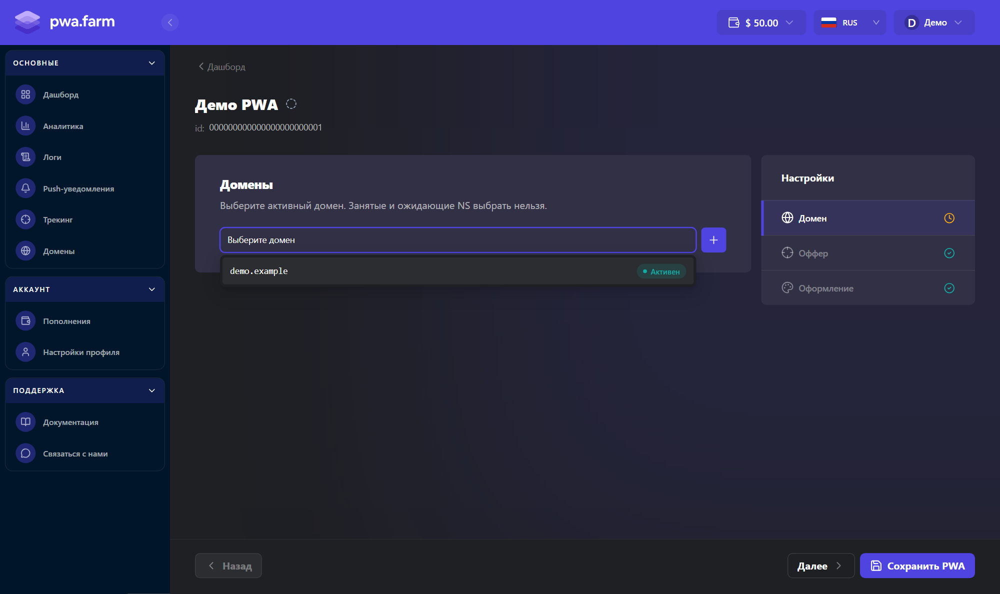
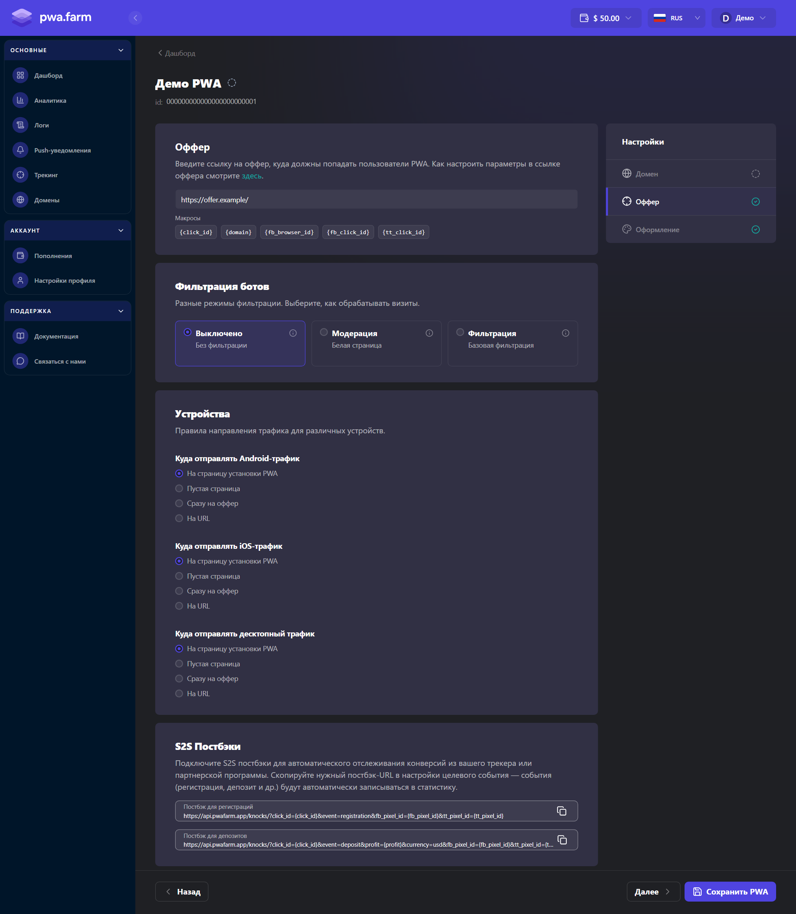
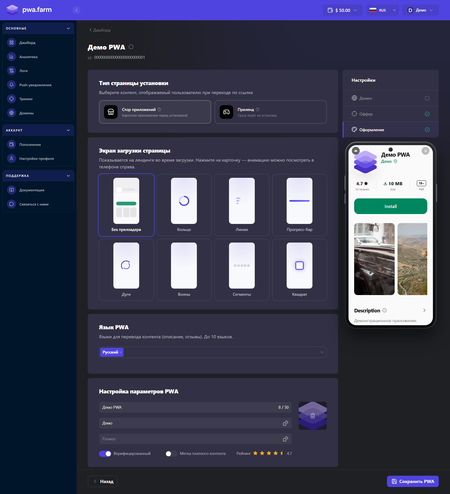
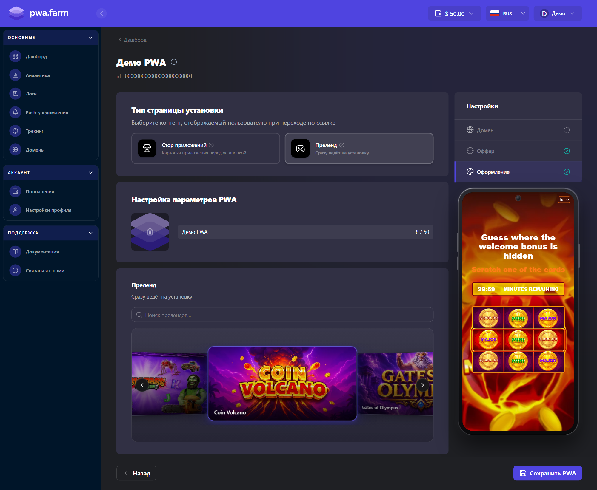

В личном кабинете откройте **Дашборд** и нажмите **Создать PWA**. PWA Farm создаст черновик и откроет редактор. На компьютере переключайтесь между этапами в панели **Настройки**. Кнопки **Далее** и **Назад** находятся внизу экрана.

## Домен

В поле **Выберите домен** укажите активный домен. Для нового PWA подойдёт домен, который ещё не назначен другому приложению.

Если подходящего домена нет, нажмите значок **Добавить домен** рядом с полем. Подключите домен, укажите NS-записи у регистратора и дождитесь статуса **Активен**. Затем вернитесь к редактору и выберите домен. [Инструкция по подключению домена](/domeny)

<Frame caption="Выбор домена на примере демонстрационного приложения">
  
</Frame>

## Оффер

Введите адрес, на который должны попадать пользователи, в поле **Ссылка оффера**. Если вы используете трекер, добавьте нужные параметры в URL с помощью кнопок в блоке **Макросы** под полем. [Макросы ссылки оффера](/makrosy)

В блоке **Фильтрация ботов** доступны режимы **Выключено**, **Модерация** и **Фильтрация**. Дополнительные ограничения по устройствам и языкам доступны в режиме **Фильтрация**. Результаты обработки визитов можно посмотреть через **Логи** в боковом меню кабинета. [Подробнее о логах](/logi)

<Frame caption="Этап «Оффер» с демонстрационной ссылкой">
  
</Frame>

В блоке **Устройства** выберите, куда отправлять пользователей Android, iOS и десктопа. Для каждой группы можно указать **На страницу установки PWA**, **Пустая страница**, **Сразу на оффер** или **На URL**. При выборе **На URL** заполните поле адреса для этой группы.

### S2S-постбэки

Если вы передаёте конверсии из трекера или партнёрской программы, в блоке **S2S Постбэки** скопируйте шаблон для нужного события и вставьте его в настройки трекера. Убедитесь, что трекер подставляет исходный идентификатор визита в `click_id` и передаёт сумму депозита в `profit`. В шаблоне депозита валюта указана как `usd`.

```text Регистрация
https://api.pwafarm.app/knocks/?click_id={click_id}&event=registration&fb_pixel_id={fb_pixel_id}&tt_pixel_id={tt_pixel_id}
```

```text Депозит
https://api.pwafarm.app/knocks/?click_id={click_id}&event=deposit&profit={profit}&currency=usd&fb_pixel_id={fb_pixel_id}&tt_pixel_id={tt_pixel_id}
```

Параметры `fb_pixel_id` и `tt_pixel_id` можно опустить, если ID соответствующего пикселя уже передан во входящей ссылке на PWA. После настройки проверьте поступление тестового события в [Аналитике](/pwa.farm%20documentation/Аналитика%20и%20метрики).

## Оформление

Выберите тип страницы установки. В обоих вариантах заполните поле **Название приложения** и загрузите иконку в блоке **Настройка параметров PWA**. В блоке **Экран загрузки страницы** можно выбрать анимацию. На компьютере предпросмотр оформления отображается справа.

### Стор приложений

Пользователь увидит карточку приложения перед установкой. В блоке **Язык PWA** выберите хотя бы один язык.

В карточку можно добавить имя разработчика, баннер, изображения и видео, описание, теги и отзывы. Тема страницы настраивается в блоке **Тема**.

<Frame caption="Оформление стора на демонстрационном приложении">
  
</Frame>

### Преленд

В галерее **Преленд** выберите шаблон. Он будет показан перед установкой PWA.

В блоке **Стиль преленда на iOS** можно выбрать тему инструкции по установке и окна запроса push-уведомлений на iOS.

<Frame caption="Выбор преленда в редакторе">
  
</Frame>

## Сохранение и проверка

1. Нажмите **Сохранить PWA**, чтобы запустить сборку. При повторном открытии приложения кнопка называется **Обновить PWA**. Если обязательных данных не хватает, редактор сохранит новое приложение как черновик и сообщит, что нужно заполнить.
2. После запуска сборки вернитесь на **Дашборд** и дождитесь статуса **Активен**.
3. Откройте привязанный домен из списка приложений. На целевых устройствах проверьте, что открывается страница, которую вы указали на этапе **Оффер**. Если для устройства выбрана страница установки, проверьте установку и переход на оффер.
