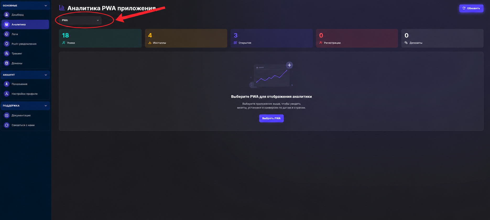
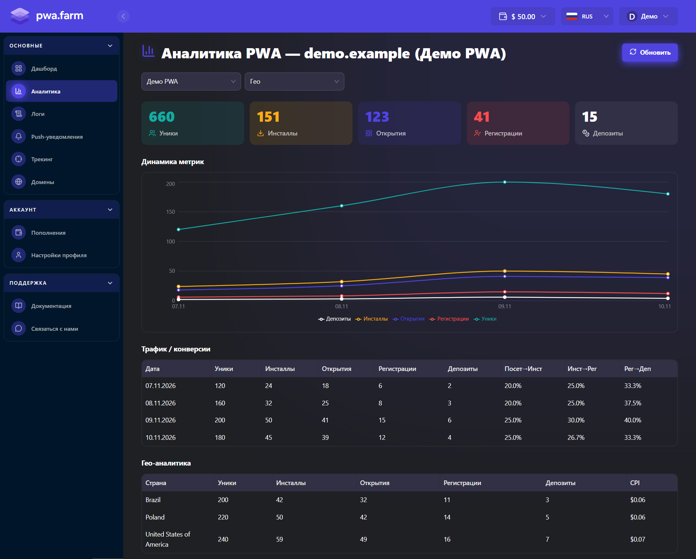
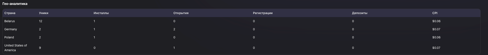

В разделе **Аналитика** видны суммарные показатели по всем вашим PWA за всё время. Чтобы посмотреть график и таблицы по дням и странам, выберите одно приложение.

## Выбрать приложение и страну

Откройте [**Аналитика**](https://www.pwafarm.app/dashboard/analytics) в боковом меню и выберите приложение в списке **PWA**. Рядом появится фильтр **Гео**. Выберите страну, чтобы отфильтровать отчёт, или **Все страны**, чтобы вернуться к полной статистике приложения. Кнопка **Обновить** загружает свежие данные.

<Frame caption="Общий обзор и список PWA">
  
</Frame>

## Что означают метрики

Эти показатели используются в карточках, графике и таблицах.

| Метрика | Что считается |
| --- | --- |
| **Уники** | Визиты с уникальными идентификаторами `click_id`. В отчёте по дням уникальность считается отдельно для каждой даты. |
| **Инсталлы** | Зафиксированные установки PWA. |
| **Открытия** | Зафиксированные запуски установленного PWA. |
| **Регистрации** | События регистрации, полученные из трекера или партнёрской программы по S2S-постбэку. |
| **Депозиты** | События депозита, полученные по S2S-постбэку. |

## Динамика метрик и конверсии

**Динамика метрик** показывает, как менялись показатели по дням. Наведите курсор на точку графика, чтобы увидеть значения за эту дату. В таблице **Трафик / конверсии** под графиком каждая строка содержит показатели и конверсии за один день.

<Frame caption="Отчёт по одному PWA с демонстрационными данными">
  
</Frame>

| Колонка | Как рассчитывается |
| --- | --- |
| **Посет→Инст** | Инсталлы ÷ уники × 100%. Если в этот день уникальных визитов нет, расчёт использует открытия. |
| **Инст→Рег** | Регистрации ÷ инсталлы × 100%. |
| **Рег→Деп** | Депозиты ÷ регистрации × 100%. |

Например, 50 установок из 200 уникальных визитов дают **25%** в колонке **Посет→Инст**. При нулевом знаменателе в таблице отображается **0%**.

События относятся к дате, когда они произошли. Если посетитель установил PWA вчера и зарегистрировался сегодня, установка и регистрация попадут в разные строки.

## Гео-аналитика и CPI

Таблица **Гео-аналитика** показывает те же метрики в разбивке по странам. **CPI** — тариф PWA Farm за одну установку в указанной стране. Ставку можно проверить на [странице тарифов](https://www.pwafarm.app/pricing).

<Frame caption="Пример разбивки метрик и CPI по странам">
  
</Frame>

## Если данных нет

Проверьте выбранное приложение и фильтр **Гео**, затем нажмите **Обновить**. Если визиты и установки уже видны, а регистрации или депозиты отсутствуют, проверьте адрес S2S-постбэка в трекере и убедитесь, что он передаёт `click_id`. [Настройка S2S-постбэков](/pwa.farm%20documentation/sozdanie-pwa-prilozheniya#s2s-постбэки)
