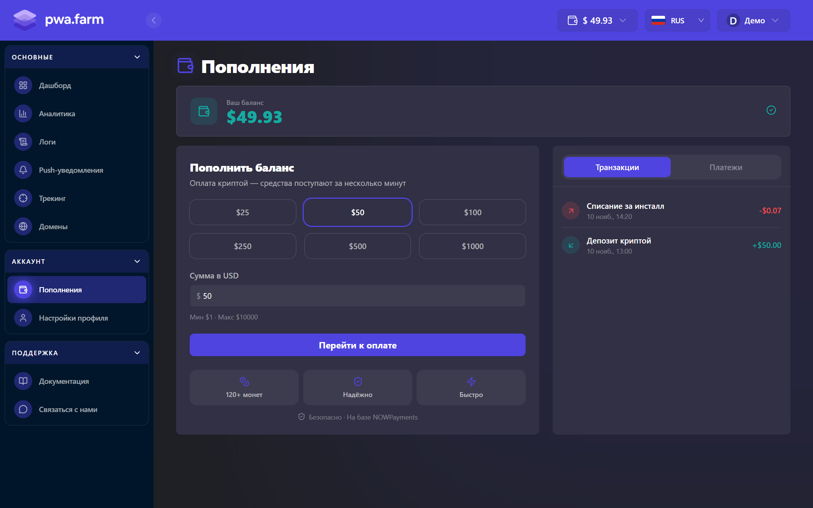

Баланс ведётся в USD. PWA Farm списывает с него плату за установки приложений.

## Сколько стоит установка

Цена зависит от страны пользователя. Хостинг, push-уведомления, аналитика и обновления включены в тариф.

| Тариф | Стоимость установки, USD |
| --- | ---: |
| Tier 1 | 0,07 |
| Tier 2 | 0,06 |
| Tier 3 | 0,05 |

Чтобы узнать цену для конкретной страны, воспользуйтесь поиском на [странице тарифов](https://www.pwafarm.app/pricing). Для стран вне таблицы действует Tier 3.

## Как пополнить баланс

1. В личном кабинете откройте [**Аккаунт → Пополнения**](https://www.pwafarm.app/dashboard/billing). Выберите готовую сумму или введите свою в поле **Сумма в USD**, затем нажмите **Перейти к оплате**. Текущий диапазон в кабинете составляет **от 1 до 10 000 USD**. Актуальные пределы указаны под полем суммы.

   <Frame caption="Раздел «Пополнения» с демонстрационными данными">
     
   </Frame>

2. На странице NOWPayments выберите криптовалюту и сеть. Проверьте итоговую сумму. Комиссию за криптоплатёж оплачивает плательщик, а [минимальная сумма перевода](https://nowpayments.io/help/payments/common/what-is-the-minimum-payment-amount) зависит от выбранной валюты и сети.
3. Проверьте, что сеть перевода совпадает с сетью в счёте. Отправьте точную сумму на адрес из счёта до истечения его срока действия.

## Где проверить зачисление

- В разделе **Пополнения** откройте вкладку **Платежи**, чтобы проверить статус счёта. Когда полная сумма будет зачислена, счёт получит статус **Завершён**.
- На вкладке **Транзакции** отображается сумма, поступившая на баланс. Найдите запись **Депозит криптой**. Если счёт **Частично оплачен**, в транзакциях может отобразиться уже зачисленная часть суммы.

Если срок счёта истёк до отправки перевода, создайте новый. Если вы отправили средства, а зачисления нет, выберите **Поддержка → Связаться с нами** и укажите идентификатор перевода (TxID).
