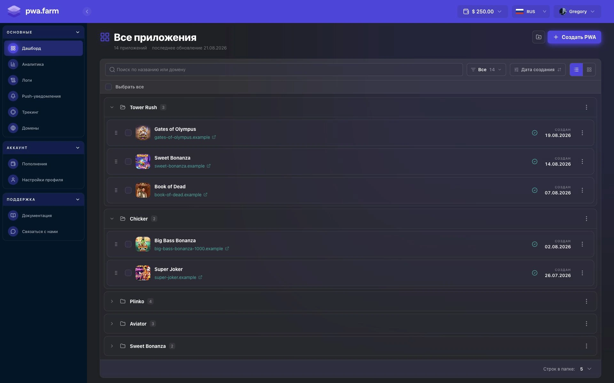

После [входа в личный кабинет](https://www.pwafarm.app/login) откроется страница **Все приложения**. Чтобы вернуться на неё из другого раздела, выберите **Дашборд** в меню.

## Навигация

На компьютере меню находится слева. На телефоне нажмите кнопку меню в верхней панели.

**Основные**

- В разделе **Дашборд** вы можете [создавать и редактировать приложения](#работа-с-приложениями).
- **Аналитика** показывает сводку по всем PWA. Выберите приложение, чтобы посмотреть его метрики, трафик и данные по странам. [Аналитика и метрики](/pwa.farm%20documentation/Аналитика%20и%20метрики)
- **Логи** показывают результаты обработки визитов. На вкладке **Фильтрация ботов** выберите приложение и при необходимости отфильтруйте визиты по результату. На вкладке **PWA** пока отображается **Coming soon**. [Логи](/logi)
- **Push-уведомления** позволяют найти уведомление по названию или создать новое. В меню создания выберите **PUSH по событиям** или **PUSH по календарю**. [Настройка push-уведомлений](/pwa.farm%20documentation/PUSH-уведомления)
- **Трекинг** позволяет добавлять пиксели Facebook и TikTok и искать их по названию, ID пикселя или платформе. [Настройка трекинга](/pwa.farm%20documentation/Трекинг)
- **Домены** позволяют добавить домен и проверить его статус и назначенное приложение. [Подключение домена](/domeny)

**Аккаунт**

- **Пополнения** открывают баланс и историю транзакций и платежей. В этот раздел также можно перейти по кнопке с балансом в верхней панели. [Пополнение баланса и тарифы](/pwa.farm%20documentation/Пополнение%20баланса%20и%20тарифы)
- **Настройки профиля** доступны также через меню аватара в верхней панели.

**Поддержка**

- **Документация** открывает справочный центр PWA Farm.
- **Связаться с нами** открывает Telegram для связи с поддержкой.

## Работа с приложениями

На странице **Все приложения** видно название каждого PWA, его статус, дату создания и привязанный домен, если он есть.

<Frame caption="Пример дашборда с приложениями в папках">
  
</Frame>

- Чтобы создать приложение, нажмите **Создать PWA**. Откроется редактор нового приложения. [Создание PWA-приложения](/pwa.farm%20documentation/sozdanie-pwa-prilozheniya)
- Чтобы найти приложение, введите название или домен в поле поиска. Можно отфильтровать список по статусу (**Все**, **Активные**, **В разработке**), отсортировать по названию или дате создания и переключиться между списком и сеткой.
- Чтобы открыть редактор, нажмите на карточку или строку приложения. Чтобы сделать копию или удалить приложение, откройте меню с тремя точками и выберите **Дублировать** или **Удалить**.
- Чтобы сгруппировать приложения, нажмите значок папки с плюсом рядом с **Создать PWA**. Введите название папки и нажмите **Создать папку**. Перетащите приложение за маркер в нужную папку.

## Настройки профиля

Откройте **Аккаунт → Настройки профиля**. В блоке **Профиль** можно загрузить или удалить аватар. Чтобы изменить отображаемое имя, заполните поле **Имя** и нажмите **Сохранить имя**.

### Изменить email

В блоке **Изменить email** введите **Новый email** и **Текущий пароль**. Нажмите **Сменить email**.

### Изменить пароль

В блоке **Изменить пароль** введите текущий пароль и новый пароль длиной не менее 8 символов. Повторите новый пароль в поле **Подтвердите пароль** и нажмите **Сменить пароль**.
